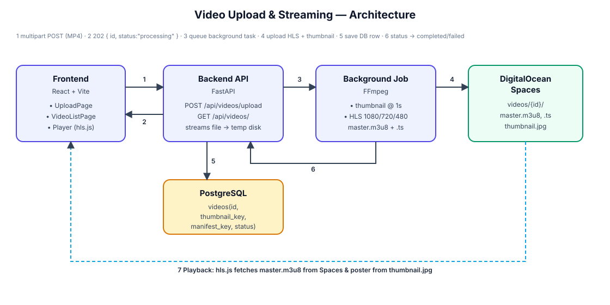

# My Video App

Full-stack video streaming application with FastAPI backend, React + Vite frontend, PostgreSQL, and HLS streaming with DigitalOcean Spaces storage.

## Project Structure

```
/my-video-app
  ├── backend/   (Python FastAPI)
  └── frontend/  (React / Vite)
```

## Features

- Upload MP4 videos via REST API
- Automatic thumbnail extraction (1 second) using FFmpeg
- HLS transcoding (adaptive streaming with master.m3u8 + segments)
- Upload to DigitalOcean Spaces (S3-compatible)
- Video list and HLS player with thumbnail preview
- PostgreSQL database for video metadata

---

## Architecture



```
Browser            Backend (FastAPI)                 Storage
───────            ─────────────────                 ───────
UploadPage ──1──▶  POST /api/videos/upload
                        │ stream MP4 → temp disk
                        │ insert row status="processing"
                   ◀─2── 202 { id, status: "processing" }
                        │
                   ┌────▼─────────────────────────┐
                   │ Background task              │
                   │  FFmpeg: thumbnail @1s       │──4──▶ DigitalOcean Spaces
                   │  FFmpeg: HLS 1080/720/480    │        videos/{id}/master.m3u8
                   │  update status="completed"   │──5──▶  videos/{id}/thumbnail.jpg
                   └──────────────────────────────┘
                        │
                   PostgreSQL  ◀──5── videos(id, thumbnail_key, manifest_key, status)

VideoListPage ────────────────────▶ GET /api/videos/  (returns manifest_url + thumbnail_url)
Player (hls.js) ───7──────────────▶ fetches master.m3u8 + thumbnail directly from Spaces
```

### Upload / processing flow (numbered)

1. **Browser → Backend** — `UploadPage` sends the MP4 as `multipart/form-data` to `POST /api/videos/upload`.
2. **Backend responds `202`** — the file is streamed to a temp dir in 8 MB chunks, a DB row is created with `status="processing"`, and the response returns immediately with `{ id, status }`. Transcoding has **not** happened yet.
3. **Queue** — the request schedules `process_video` as a `BackgroundTask`.
4. **FFmpeg + Spaces** — the background job extracts the thumbnail (`@1s`) and transcodes the HLS ladder, then uploads everything to `videos/{id}/` on Spaces (public-read).
5. **DB update** — the row is updated with `thumbnail_key`, `manifest_key`, and `status="completed"` (or `"failed"` on error), and the temp dir is deleted.
6. **Status** — `GET /api/videos/{id}` returns the current `status`.
7. **Playback** — the player (hls.js) loads `master.m3u8` from Spaces and uses `thumbnail.jpg` as the poster.

### Where the frontend "waits" (important)

The frontend does **not** wait for transcoding, and it shouldn't:

- The `await axios.post(...)` in `UploadPage` resolves when the **bytes finish uploading** to the backend — that's what the progress bar measures.
- The backend returns `202` as soon as the file is on disk, so the HTTP request never times out on long transcodes.
- The heavy work happens in the background; the UI just shows `processing` at first.

So to see a video become playable, the frontend must **poll** `GET /api/videos/{id}` until `status === "completed"`. The current code fetches the list once on mount (`VideoListPage`), so a manual refresh is needed. To make it "sit and wait", poll:

```js
useEffect(() => {
  if (!result?.id) return
  const t = setInterval(async () => {
    const { data } = await axios.get(`${API_URL}/api/videos/${result.id}`)
    setResult(data)
    if (data.status !== 'processing') clearInterval(t)
  }, 3000)
  return () => clearInterval(t)
}, [result?.id])
```

---

## Prerequisites

- Docker & Docker Compose (recommended)
- Or: Python 3.11+, Node.js 20+, PostgreSQL, FFmpeg installed locally

---

## Running with Docker (Recommended)

Docker ports are intentionally different from common defaults to avoid conflicts:

| Service | Docker Host Port | Internal Port |
|---|---|---|
| Backend | 8001 | 8000 |
| Frontend | 5174 | 5174 |
| PostgreSQL | 5433 | 5432 |

### 1. Configure environment variables

```bash
cp backend/.env.example backend/.env
# Edit backend/.env with your DigitalOcean Spaces credentials
```

### 2. Run all services

```bash
docker-compose up --build
```

Frontend: http://localhost:5174  
Backend API: http://localhost:8001  
API Docs: http://localhost:8001/docs

### 3. Run separately

Backend only:
```bash
docker-compose -f docker-compose.backend.yml up --build
```

Frontend only:
```bash
docker-compose -f docker-compose.frontend.yml up --build
```

---

## Running without Docker

### Backend Setup

1. Ensure PostgreSQL is running (default port 5432)
2. Install FFmpeg locally
3. Configure `.env`:
```bash
cd backend
cp .env.example .env
# Edit DATABASE_URL, SPACES_* values
```
4. Install dependencies:
```bash
pip install -r requirements.txt
```
5. Run server:
```bash
uvicorn app.main:app --reload --host 0.0.0.0 --port 8000
```

### Frontend Setup

1. Configure `.env`:
```bash
cd frontend
cp .env.example .env
# VITE_API_URL=http://localhost:8000
```
2. Install dependencies:
```bash
npm install
```
3. Run dev server:
```bash
npm run dev
```

Frontend: http://localhost:5173 (default Vite port)  
Backend: http://localhost:8000

Note: If running without Docker, ensure ports don't conflict. Docker setup uses 8001/5174/5433 to avoid clashes.

---

## API Endpoints

- `GET /` - Health check
- `GET /api/videos/` - List all videos
- `GET /api/videos/{id}` - Get one video (status polling)
- `POST /api/videos/upload` - Upload MP4 file (returns `202` immediately; processing runs in background)

---

## Large files (movies, 3GB+)

The upload flow is designed to handle multi-GB movies:

- The file is **streamed to disk in 8 MB chunks** (`aiofiles`), so it never loads fully into RAM.
- The endpoint returns `202` with `status: "processing"` right away.
- Thumbnail extraction, HLS transcoding, and the Spaces upload run in a **background task**.
- `status` becomes `completed` (with URLs) or `failed`. Poll `GET /api/videos/{id}`.

Practical notes:

- **Transcoding time**: a 3GB / 2h movie takes a long time (CPU bound). The API stays responsive but the job runs in-process.
- **Disk space**: keep enough free temp space (roughly the source size + HLS output). Files are removed after processing.
- **Job durability**: `BackgroundTasks` do not survive a server restart. For production, use a real queue (Celery + Redis, or RQ) and a worker container.
- **Reverse proxy**: if put behind nginx, raise `client_max_body_size` (e.g. `client_max_body_size 4g;`) and proxies read timeouts. Uvicorn/FastAPI itself imposes no body-size limit.
- **Renderings**: renditions are chosen based on the source height (no upscaling). A 1080p source produces 1080p/720p/480p adaptive variants.

---

## Testing

1. Upload an MP4 file via frontend (http://localhost:5174)
2. View videos list and play with HLS.js player
3. API docs available at http://localhost:8001/docs when using Docker or http://localhost:8000/docs without Docker

Note: actual upload requires valid DigitalOcean Spaces credentials in `backend/.env`. Without them the record is created and the job ends with `status: "failed"` at the storage step.
